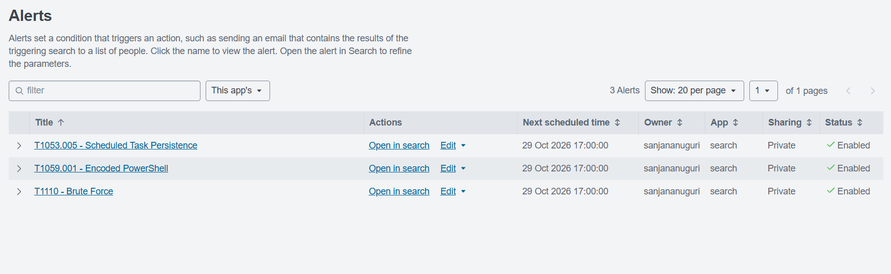

# mdr-triage-lab
# MDR Alert Triage and Auto-Resolution Lab

A home SOC lab that mirrors an MDR analyst workflow: generate attacker telemetry, detect it in Splunk, triage and escalate true positives, and auto-resolve known-benign alerts with a Trusted Behavior Registry-style allowlist.

**Result: 16 alerts triaged, 11 auto-resolved (69% noise reduction), 5 escalated. Every real attack was escalated and none were suppressed.**

## Architecture
Windows 11 VM (Sysmon + Splunk Universal Forwarder) -> Splunk Enterprise on host (index `win`) -> alerts.csv export -> Python allowlist engine -> resolved.csv / escalated.csv

## Lab setup
- VirtualBox Windows 11 VM on NAT, Sysmon with the SwiftOnSecurity config
- Splunk Universal Forwarder sending Security and Sysmon logs to Splunk Enterprise (port 9997)
- Sysmon events arrive as XML, so fields (Image, CommandLine, ParentImage, User) are extracted with `rex`
- Telemetry generated with Atomic Red Team plus simulated benign IT activity
  

## Detections
| ATT&CK | Detection | Logic |
|---|---|---|
| T1059.001 | Encoded PowerShell | Sysmon EventCode 1, powershell.exe with -enc or -EncodedCommand |
| T1110 | Brute force | 10 or more Windows 4625 failed logons in 5 minutes |
| T1053.005 | Scheduled task persistence | Sysmon EventCode 1, schtasks.exe with /create |

## Auto-resolution (mini Trusted Behavior Registry)
`auto_resolve.py` compares each alert to `allowlist.json`. Every entry has an ID, a narrow match, and a documented reason, so it cannot suppress a real attack.

| ID | Rule | Match | Reason |
|---|---|---|---|
| TBR-001 | Encoded PowerShell | parent image inventory_agent.exe | Approved IT inventory agent |
| TBR-002 | Scheduled Task | command line BackupNightly | Approved nightly backup job |

Validation: all Atomic Red Test activity landed in `escalated.csv`.

## Escalation reports
See the `reports/` folder: 
- [Report 1: Encoded PowerShell](reports/01-encoded-powershell.md)
- [Report 2: Scheduled Task Persistence](reports/02-scheduled-task-persistence.md)
- [Report 3: Brute Force](reports/03-brute-force.md)

## Lessons learned
- Forwarder access to the Sysmon log needed Event Log Readers permission (errorCode=5)
- VM clock drift after a saved-state resume stopped log forwarding
- Allowlist entries must be narrow and documented, then validated against true positives

## Next steps
T1105 ingress tool transfer detection, SOAR-style playbook, Sentinel/KQL version.

## Files
alerts.csv, allowlist.json, auto_resolve.py, resolved.csv, escalated.csv
